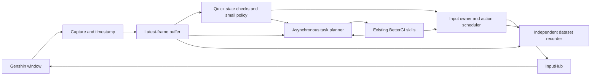

# A local learning agent for BetterGI

Research date: October 23, 2026. Machine: the Windows workstation running this fork. Source baseline: `eb3270862ed2f99aea4abc637b7e555c863c27df`.

## Recommendation

Start here with a hybrid agent: BetterGI executes its existing skills, a small learned controller fills gaps in movement and recovery, and an asynchronous planner selects objectives and handles unfamiliar situations. Train or fine-tune small components on demonstrations collected through BetterGI. Reproducing Lumine's complete training recipe is beyond this machine's resources.

The immediate priority is the observation and control pipeline. Historical pilot traces already show approximately one second per observation, with substantial time spent on OCR and synchronous PNG writing. A stronger model alone would inherit those delays. The first project should establish continuous capture, independent recording, synchronized action labels, and reliable execution before investing in training.

The strongest new model to evaluate is **GameScaling-0.8B-S3**, released with the GameScaling research this week. **Open P2P's 150M policy** is the second candidate, especially for a small movement controller. Neither has been benchmarked on this machine, and neither establishes broad Genshin competence out of the box. Start with an offline comparison, then a narrow supervised live evaluation.

The practical objective is progressively broader task coverage with fewer interventions. Finishing known routes and recovering from ordinary interruptions comes before claiming autonomous completion of unfamiliar quests, puzzles, and every combat mechanic.

## What was verified locally

The [machine audit](D:/work/genshin-auto/artifacts/research/2026-10-23/machine-audit.json) records the hardware and installed software. Free memory and storage are snapshots, not reservations.

| Item | Verified state | Consequence |
|---|---|---|
| GPU | NVIDIA RTX 2080 SUPER, 8,192 MiB VRAM, Turing / compute capability 7.5 | Suitable for investigating small policies and limited fine-tuning; simultaneous game and model memory must be measured. |
| GPU driver | 572.70 | Begin with a compatible CUDA 12.x stack. CUDA 13 requires a newer driver family. |
| CPU | Ryzen 9 3900X, 12 cores / 24 threads | Useful for capture processing, encoding, data preparation, and background planning. |
| RAM | Approximately 32 GiB installed; approximately 14 GiB available at inspection | Enough to begin; do not copy large workstation WSL memory settings. |
| Python | 3.11.9 | Keep the current installation intact and create isolated project environments. |
| PyTorch | Imported version `2.7.1+cpu`; CUDA unavailable | GPU training is not configured yet. |
| Other ML packages | Transformers 4.40.2; CPU ONNX Runtime 1.22.0; no PEFT, Accelerate, bitsandbytes, or GPU ONNX Runtime found | Current packages do not constitute a modern game-agent environment. |
| WSL | Windows tooling present, no Linux distribution installed | Linux-first serving and training stacks require additional setup. |
| Video tools | FFmpeg present | Compressed demonstrations can be collected without storing every frame as PNG. |

Storage was mapped to its actual devices:

| Drive | Device / connection | Approximate free space | Suggested role |
|---|---|---:|---|
| C: | Samsung 990 PRO, NVMe | 516 GiB | Optional future training cache or temporary data, after choosing an authorized location. |
| D: | Kingston SA400, SATA SSD; current repository | 178 GiB | Initial bounded dataset, code, and experiment records. |
| G: | 8 TB Seagate drive over USB | 7.07 TiB | Potential dataset archive. |
| N: | QNAP iSCSI storage | 7.99 TiB | Potential network archive; measure throughput before training directly from it. |

No CUDA environment, Linux distribution, model weights, or training job was installed or started during this research. No game input was sent. The existing package validation reports successful builds and substantial automated test coverage, but explicitly records no live game test and 18 inherited experimental JavaScript test failures. That establishes a build baseline, not agent readiness. [Local validation record](D:/work/genshin-auto/artifacts/validation-report.json)

## What Lumine demonstrates, and its resource requirements

Lumine uses a Qwen2-VL-7B base, visual history, and staged gameplay, instruction, and reasoning training. Its paper describes 5 Hz visual observations and six approximately 33 ms action steps per response. The history-enabled pretraining stage used 64 H100 GPUs for 19,008 GPU-hours; the three reported history-enabled stages total 20,736 GPU-hours. Inference ran on four H20 GPUs. Its reported multi-hour story demonstration is evidence of substantial capability, rather than proof of complete game coverage. These measurements do not predict performance on an RTX 2080 SUPER. [Lumine paper](https://arxiv.org/html/2511.08892v1)

The official project reports 1,731 hours of curated pretraining data, 200 hours of instruction data, and 15 hours of reasoning data. I could not verify an official downloadable checkpoint or complete training release from the project materials inspected. [Official Lumine project](https://www.lumine-ai.org/)

Public checkpoints using the Lumine name need provenance checks. One inspected third-party card describes a 30-minute reproduction and warns that its older checkpoint lacks custom tokens. It is not the official ByteDance model. [Third-party model card](https://huggingface.co/koboshchan/Lumine-Agent-Pretraining-VL-7B)

The transferable ideas are temporal context, action sequences, task-conditioned demonstrations, and separation between frequent action generation and occasional reasoning. We can adopt those ideas at a smaller scale while reusing BetterGI's existing capabilities.

## Model candidates

| Candidate | Released material and relevant behavior | Role in this project | Main uncertainty |
|---|---|---|---|
| GameScaling-0.8B-S3 | Keyboard/mouse policy; listed checkpoint weights about 2.2 GB in BF16; Apache 2.0. Inference code is released; training code is not. | First pretrained policy to benchmark. | Turing precision and kernel compatibility, actual memory use, and Genshin transfer. |
| Open P2P 150M | Small keyboard/mouse policy; training code and checkpoints released under MIT. | Second candidate; potentially useful as a fast movement controller. | Dependency setup, temporal-context memory, and local inference latency. |
| NitroGen 500M | Released visual policy using gamepad actions; model weights use NVIDIA's license. | Reference or later experiment. | BetterGI's gamepad backend is currently a placeholder, so integration needs additional work. |
| SmolVLM2-500M-Video-Instruct | Small image/video language model, Apache 2.0. | Optional slower scene interpreter or labeling assistant. | It is not a pretrained keyboard/mouse game policy. |
| Compact custom temporal vision policy | A model we would train for a narrow action vocabulary. | Fallback if pretrained stacks fail the hardware or latency gates. | Requires our own demonstrations and explicit limits on task scope. |

Sources: [GameScaling repository](https://github.com/THUSI-Lab/GameScaling), [0.8B-S3 checkpoint](https://huggingface.co/THUSI-Lab/GameScaling-0.8B-S3), [Open P2P repository](https://github.com/elefant-ai/open-p2p), [Open P2P weights](https://huggingface.co/elefantai/open-p2p), [NitroGen model card](https://huggingface.co/nvidia/NitroGen), [SmolVLM2 model card](https://huggingface.co/HuggingFaceTB/SmolVLM2-500M-Video-Instruct).

**GameScaling is promising but needs a compatibility experiment.** Its October 20 paper studies cross-game transfer. Genshin is absent from the listed 80-game inventory, and the reported evaluations do not establish Genshin performance. The small-model real-time measurements used an H200; the larger models used multiple H200s. Treat transfer and consumer-GPU speed as open questions. [GameScaling paper](https://arxiv.org/html/2610.28698v1)

Its action interface needs careful adaptation: preserve the checkpoint's custom chat template and action tokens, use its action-only mode for the frequent control path, and convert mouse deltas from per-mille screen units. Its published serving script defaults to BF16, a 32K context, and 85% GPU memory utilization. Those are unsuitable starting defaults for an 8 GB GPU shared with Genshin. [Inference interface](https://github.com/THUSI-Lab/GameScaling), [published serving script](https://raw.githubusercontent.com/THUSI-Lab/GameScaling/main/scripts/serve_vllm.sh)

**Open P2P has a useful smaller-policy design.** Its paper uses low-resolution visual encoding and temporal context. The released setup targets Linux training and a Windows game bridge; the repository's live setup was tested with a 5090 for inference and a 5080 for the game. Its 20 Hz target is not a measurement on this workstation. Current dependencies include Python 3.13.2, CUDA 12.8 wheels, a specific Transformers fork, and additional native components. Use its own environment and inspect tokenizer access requirements before setup. [Open P2P paper](https://arxiv.org/html/2601.04575v1), [repository](https://github.com/elefant-ai/open-p2p), [dependency manifest](https://raw.githubusercontent.com/elefant-ai/open-p2p/main/pyproject.toml)

NitroGen's own repository says it does not provide long-horizon planning or end-to-end game completion. Its usefulness here would be a component experiment, even after building a compatible gamepad path. [NitroGen repository](https://github.com/MineDojo/NitroGen)

## What BetterGI already supplies

This assessment concerns the checked-out fork at the source revision above. File presence indicates reusable implementation, not verified success in every current game situation.

| Existing component | What we can reuse | Work still needed |
|---|---|---|
| Bound game runtime | Window, capture, input, cancellation, and runtime lifecycle | Publish timestamped observations without tying capture to OCR or disk writes. |
| InputHub and TaskRunner | Central input path, task exclusion, cancellation, release of held inputs | One explicit agent input owner, action expiry, execution receipts, and skill adapters. |
| Key/mouse recorder | Human keyboard, mouse, timing, viewport, and DPI information | Synchronize frames and inputs using a monotonic clock; record actual automated actions too. |
| Existing game tasks | Pathing, combat routines, domains, pickup, dialogue, fishing, and other routines | Give selected tasks explicit preconditions, completion signals, failure reasons, and cancellation behavior. |
| Recognition / ONNX services | OCR and established visual recognizers | Separate quick HUD checks from expensive general interpretation. |
| Supervised quest pilot | Frame IDs, request expiry, observations, receipts, session checks, and useful traces | A continuous autonomous loop and training-oriented data transport. |
| External interfaces | Health/version HTTP endpoints, logs, and a restricted local control protocol | A purpose-built observation/action bridge; there is no existing general `step()` API. |

Local source anchors: [GameRuntime](D:/work/genshin-auto/BetterGenshinImpact/GameTask/Runtime/GameRuntime.cs:15), [InputHub](D:/work/genshin-auto/BetterGenshinImpact/Core/Input/InputHub.cs:15), [TaskRunner](D:/work/genshin-auto/BetterGenshinImpact/GameTask/TaskRunner.cs:171), [recorder](D:/work/genshin-auto/BetterGenshinImpact/Core/Recorder/KeyMouseRecorder.cs:17), [recording lifecycle](D:/work/genshin-auto/BetterGenshinImpact/Core/Recorder/GlobalKeyMouseRecord.cs:22), [recognition runtime](D:/work/genshin-auto/BetterGenshinImpact/Core/Recognition/ONNX/InferenceRuntimeService.cs:15), [pilot documentation](D:/work/genshin-auto/BetterGenshinImpact/User/JsScript/ActOnePilot/README.txt), [HTTP host](D:/work/genshin-auto/BetterGenshinImpact/Service/ExternalAccess/ExternalAccessHost.cs:291), [control protocol](D:/work/genshin-auto/BetterGenshinImpact/Service/ExternalControl/ExternalControlProtocol.cs:88).

Two integration details matter:

- `TaskRunner` rejects nested task sessions. An agent episode should own one task scope and invoke compatible underlying skill operations within it. Starting a new `TaskRunner` from each skill would conflict with the current ownership model.
- The existing human recording mode stops the real-time trigger timer. It cannot simply be switched on to collect every BetterGI-driven demonstration. Instrument the executed input path for automated demonstrations and use the human input hook for human demonstrations.

The [gamepad backend](D:/work/genshin-auto/BetterGenshinImpact/Core/Input/Backends/Gamepad/GamepadInputBackend.cs:8) currently reports unsupported operations. The pilot also enforces a particular RDP child-session and normalized capture setup. A new agent mode needs an explicitly tested runtime configuration; changing a few pilot flags would not establish general local compatibility.

## The measured source of existing pauses

The historical `act-two-events.jsonl` file contains 2,994 JSON records, including 30 explicit `observation_timing` records. Their reported values are:

| Stage | Median | 95th percentile, nearest rank |
|---|---:|---:|
| Capture | 3 ms | 9 ms |
| Timed OCR calls (`ocrFindMultiMs`) | 436 ms | 1,038 ms |
| PNG writing | 498 ms | 658 ms |
| Total observation | 999 ms | 1,520 ms |

These are historical measurements of the supervised pilot pipeline, not a fresh benchmark of the current build or all of BetterGI. Component medians do not necessarily sum to the median total. The legacy `ocrMs` field has a 438 ms median, but its cumulative window can include later work on fallback paths; the table therefore uses the narrower OCR-call timer. The [derived trace summary](D:/work/genshin-auto/artifacts/research/2026-10-23/pilot-trace-summary.json) includes sample counts, the source hash, and limitations. [Timing definitions](D:/work/genshin-auto/BetterGenshinImpact/User/JsScript/ActOnePilot/bgi.js:8351)

The current general observation path still calls `writeImageSync`, while some bounded pilot primitives already take fast samples without writing PNGs. Reuse those lessons when building the continuous loop; the approximately one-second historical total does not describe every existing primitive. [General observation write](D:/work/genshin-auto/BetterGenshinImpact/User/JsScript/ActOnePilot/bgi.js:8008), [bounded fast sample](D:/work/genshin-auto/BetterGenshinImpact/User/JsScript/ActOnePilot/bgi.js:3365)

This evidence supports an immediate experiment: compare the existing observation path against capture alone, capture plus targeted recognition, and capture with asynchronous recording. The intended result is a short control path whose timing is independent of PNG compression and full-screen OCR. Measure the actual improvement before attributing a specific speedup to either change.

Use OCR when dialogue, objectives, or menus change, and at a bounded refresh interval where necessary. Give each recognized field its own timestamp and confidence. A recent frame containing old OCR must not be presented to the planner as a completely fresh observation.

## Proposed architecture

**Capture and execution:** keep a bounded latest-frame buffer and timestamp frames with a monotonic clock. Schedule accepted action chunks independently of inference. A 30 Hz scheduler is a design target; discrete taps still need game-appropriate hold and release intervals, especially at 30 fps. Measure those intervals instead of blindly replaying rapid transitions.

**Policy and skills:** aim first for 5 policy decisions per second where the measured model latency permits it. Existing BetterGI skills can handle known paths, rotations, and interaction routines. A small policy can specialize in positioning, local movement, camera correction, and recovery. If the model cannot meet the decision deadline, use it at a slower level and retain a proven controller for frequent actions.

**Planning:** maintain a task graph, current objective, inventory/resource constraints, and recent outcomes. Trigger planning on task completion, changed objectives, unfamiliar screens, or failure. Start with explicit state transitions and skill selection. Add model-based interpretation where it solves a demonstrated gap. Slow reasoning should happen while a valid skill is running, with stale planning results discarded when the objective changes.

**Execution ownership:** every model or skill proposal goes through one input owner. Validate the runtime, session, goal version, originating frame, action vocabulary, numeric limits, and expiry before execution. Keep requested and actually executed actions separately. Losing focus, disconnecting, cancelling, or expiring an action releases held input. Never extend an expired action merely to conceal model latency.

**Resource sharing:** initially keep at most one substantial GPU model resident. The game, recognition services, visual encoder, context cache, and training process all compete for the same 8 GB. Train with the game closed. Measure game frame rate and VRAM pressure during inference tests; a model-only benchmark is insufficient.

**Recording:** encode video and write metadata away from the control path. Bound queues, record dropped-frame intervals, and make dataset recording failure visible. Keep action events lossless within a recording session; reject damaged segments from training. Existing screenshot storage limits are useful safeguards but do not replace a video dataset manager. [Current capture budget](D:/work/genshin-auto/BetterGenshinImpact/Core/Script/Dependence/CaptureStorageBudget.cs)

## BetterGI as a learning environment

BetterGI can be the game-facing instrumentation and execution layer. It does not currently provide a resettable simulator. The live game has server-side progress, non-repeatable story states, loading delays, limited reward visibility, and no general fast-forward operation.

A Gymnasium-style wrapper could expose `observe`, `step`, and `reset` conventions, but must report real limitations. A reset can return to a verified waypoint or repeatable activity when available. For a one-time quest it may require an operator or be unsupported. A saved JSON observation cannot restore the game world. Gymnasium's API defines the interaction contract; building that contract does not create deterministic resets. [Gymnasium environment API](https://gymnasium.farama.org/api/env/)

Begin with demonstrations and imitation learning. Use supervised corrections after the policy encounters states outside the demonstration distribution, following the motivation behind DAgger. Save human takeovers and recovery actions as high-value training examples. Avoid beginning with reinforcement learning from scratch against a slow, irreversible live environment. [DAgger paper](https://proceedings.mlr.press/v15/ross11a.html)

Reward signals should be explicit and traceable: a verified interaction, reached destination, completed combat task, or recognized quest transition. Record which detector supplied the signal and its confidence. Do not interpret an uncertain OCR change as reliable ground truth. Offline video replay is useful for training and analysis, but cannot evaluate the consequence of an action that was never executed.

## Dataset and training plan

Record both human play and selected successful BetterGI routines. Scripted runs are inexpensive experts for narrow skills; human demonstrations supply interpretation, unusual movement, puzzle behavior, and recovery. Include unsuccessful episodes and label their outcomes rather than silently treating all automated actions as correct.

Each episode needs:

- Build revision, model revision, task instruction, game language, viewport, DPI, capture method, and mouse sensitivity/calibration.
- Frame IDs, monotonic timestamps, video presentation timestamps, and explicit capture gaps.
- Human or automated action source; requested and executed held keys, mouse buttons, relative movement, absolute GUI movement, and scroll events.
- Action issue/start/end times, originating observation, goal version, and execution result.
- Task outcome, intervention points, failure reason, and available state measurements with their own timestamps.

Bind capture to the game window and exclude desktop-only frames. Keep account identifiers out of training exports. Preserve the original recording locally when needed for debugging, and generate training views with an explicit transformation manifest.

Start with **10–20 hours of curated demonstrations**, expanding only when learning curves justify it. At 5 sampled observations per second this yields 180,000–360,000 correlated training examples, not that many independent situations. Split by complete sessions, routes, and task variants so adjacent frames cannot leak between training and evaluation.

Suggested initial curriculum:

| Stage | Tasks | Desired learning |
|---|---|---|
| 1 | Known waypoint-to-target routes, camera alignment, interaction prompts | Basic control and grounded interaction. |
| 2 | Obstacles, missed interactions, wrong orientation, menus, loading transitions | Recovery and accurate termination. |
| 3 | Selected team/combat routines in repeatable activities | Positioning and skill selection around existing combat execution. |
| 4 | Dialogue and short quest segments | Objective memory, menu interpretation, and task chaining. |
| 5 | New puzzles, unusual combat mechanics, and unfamiliar quest layouts | Generalization experiments with new demonstrations and held-out scenarios. |

For GameScaling, first prove loading and forward passes with compatible precision, then test a tiny adapter-training batch for finite loss and gradients. Consider small LoRA adapters with frozen base weights and short visual context. Quantized adapter training can reduce memory, but multimodal activations and context remain material costs. Compatibility and peak memory must be measured before calling QLoRA feasible for this exact model. [PEFT quantized training documentation](https://huggingface.co/docs/peft/main/en/developer_guides/quantization)

For Open P2P or a custom small controller, begin with short temporal sequences and a narrow action set. Preserve the original checkpoint's preprocessing and action semantics until a controlled comparison justifies changes. Measure task success alongside training loss; predicting common movement keys well does not establish competence.

At a proposed video bitrate of 8–12 Mbps, recordings use approximately 3.6–5.4 GB per hour before metadata and checkpoints. Ten to twenty hours therefore needs approximately 36–108 GB of video. Begin with a roughly 60 GiB recording budget on D:, retain at least 30 GiB free, and archive deliberately before expansion. These are planning calculations, not measured encoder quality or file sizes. Keep model weights and datasets outside Git and do not add `BetterGenshinImpact/Assets`.

## Windows and GPU compatibility work

Create isolated environments and record exact package versions, source revisions, model hashes, and license files. Keep the existing BetterGI Python and .NET setup working. GameScaling and Open P2P should have separate environments because their framework requirements differ.

The following constraints are verified from current primary documentation:

- Current vLLM is Linux-based and does not support native Windows. Its documented GPU minimum includes compute capability 7.5, but that alone does not establish support for a particular model's kernels. WSL is a possible deployment route after a deliberate setup decision. [vLLM GPU installation](https://docs.vllm.ai/en/latest/getting_started/installation/gpu/)
- Qwen3.5 uses hybrid attention components. Transformers documents optional fast kernels and a slower, more memory-intensive fallback when they are absent. The installed Transformers version predates this model family. [Qwen3.5 documentation](https://huggingface.co/docs/transformers/model_doc/qwen3_5)
- Stock FlashAttention 2 targets Ampere and newer NVIDIA architectures; its documentation points Turing users to a separate implementation. BF16 hardware acceleration is also unavailable on this Turing GPU. Start with supported FP16/FP32 paths and validate numerical behavior. [FlashAttention support](https://github.com/Dao-AILab/flash-attention)
- bitsandbytes lists Windows support and SM75-compatible capabilities, making quantization worth testing. That does not establish end-to-end Qwen3.5 or adapter-training compatibility. [bitsandbytes installation](https://huggingface.co/docs/bitsandbytes/installation)
- CUDA 13 requires a newer driver family than the installed 572.70. Select a compatible CUDA 12.x package stack and check its specific kernel requirements. A separate CUDA toolkit is not automatically necessary for prebuilt PyTorch wheels. [NVIDIA compatibility guidance](https://docs.nvidia.com/deploy/cuda-compatibility/minor-version-compatibility.html), [PyTorch installation](https://pytorch.org/get-started/locally/)

The first environment experiment should load one model, process a fixed set of saved game frames, and report latency, memory, parse validity, and numerical failures. It should send no game input. Do not begin by downloading every candidate or copying high-memory serving defaults.

## Milestones and acceptance gates

The [first-sprint checklist](D:/work/genshin-auto/Docs/research/BetterGI-Agent-First-Sprint.md) makes the initial work concrete. The following are proposed gates, not achieved results.

| Milestone | Deliverable | Evidence required before advancing |
|---|---|---|
| 1. Measure and shorten observations | Capture/recognition/recording ablation and bounded asynchronous recording | Fresh p50/p95 timings, observation age, recording gaps, and game frame rate. |
| 2. Record aligned demonstrations | Video, actual action events, and episode manifests | Verified frame/action alignment, explicit missing-data detection, and replayable labels. |
| 3. Establish execution ownership | Local observation/action bridge and skill adapters | Held keys release on cancellation, focus loss, disconnect, and expiry; competing owners rejected. |
| 4. Compare small models | GameScaling 0.8B and Open P2P 150M compatibility/latency results where setup succeeds | Fixed-input comparisons, peak VRAM, cold/warm latency, parse validity, and game-running measurements. |
| 5. Adapt one narrow skill | Small training run plus held-out task evaluation | Improvement over scripted and unfine-tuned baselines on complete held-out episodes. |
| 6. Chain skills and recover | Multi-step task graph with bounded automatic recovery | Sustained task completion, lower interventions/hour, and accurate failure reporting. |

A provisional fast-policy gate is **p95 capture-to-first-action latency at or below 200 ms** for a 5 Hz decision cycle, while preserving acceptable game frame rate and GPU headroom. If a candidate fails, move it to slower interpretation or replace it with a smaller controller. Do not relabel slow inference as real-time performance.

Begin live evaluation with five repeatable task variants and ten trials each, where the game actually supports repetition. Later expand to ten variants and longer sessions. Evaluate one-time quests separately. Report completion rate, interventions/hour, recovery success, stale-action rejection, input-release failures, frame rate, latency, and memory. Count malformed or expired proposals as failures. Compare the existing scripted baseline, the pretrained model, the fine-tuned model, and the hybrid agent.

Broad autonomy needs explicit coverage evidence across navigation, combat, dialogue, menus, puzzles, and quest transitions. A successful one-hour route or one story segment is a milestone rather than a substitute for that coverage.

## Decision for this machine

Proceed with instrumentation, data collection, a reliable executor, and small-policy experiments on the current workstation. No hardware purchase or cloud training is needed to begin the project. The first useful result is an agent that completes selected sequences and handles ordinary recovery without repeated manual mission submissions.

Do not commit to a large training run until the local inference benchmark and a small fine-tuning experiment pass. If memory or latency blocks the intended scope after optimization, use those measurements to choose between a smaller policy, slower high-level model use, or additional compute. Broad unfamiliar quest and puzzle competence remains a research objective with uncertain effort, rather than an outcome that can be guaranteed by a particular model size.

Research status: hardware and code inspected; primary sources reviewed; historical timing data analyzed; implementation and evaluation plan prepared. Model inference, fine-tuning, and live agent performance remain untested.
